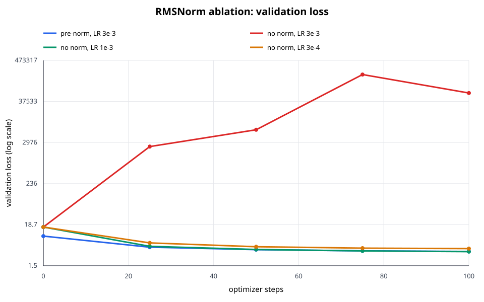
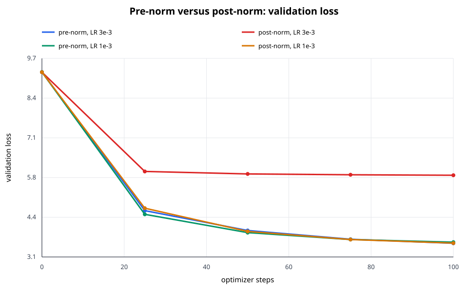
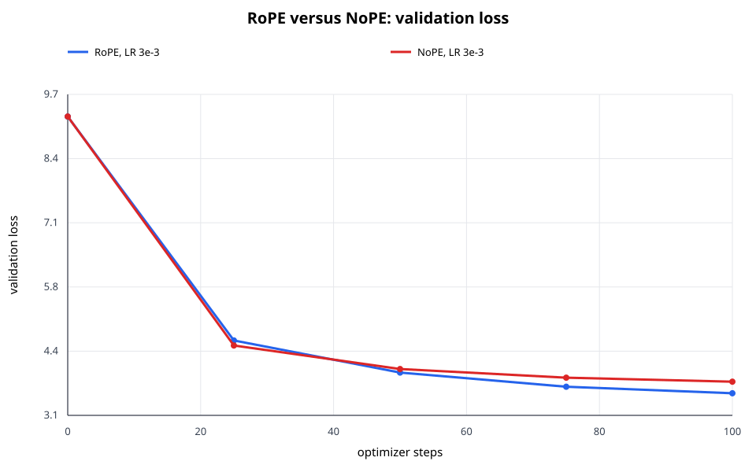
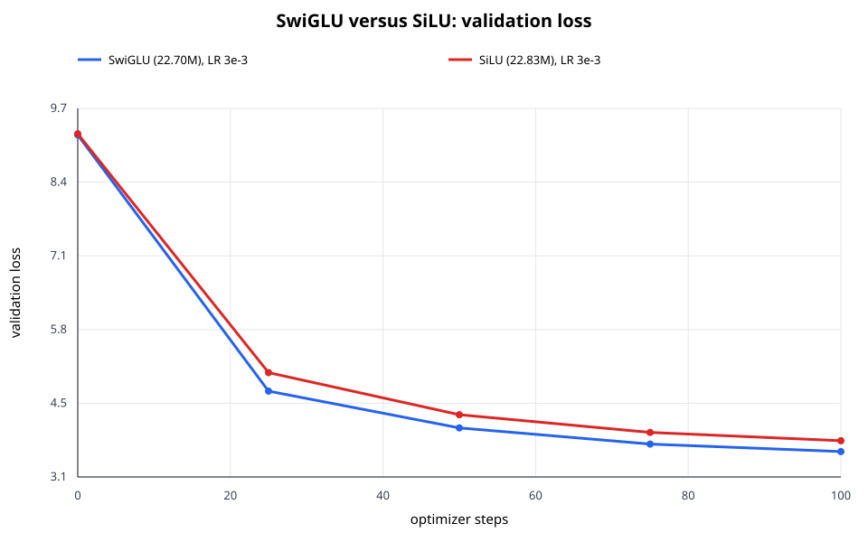
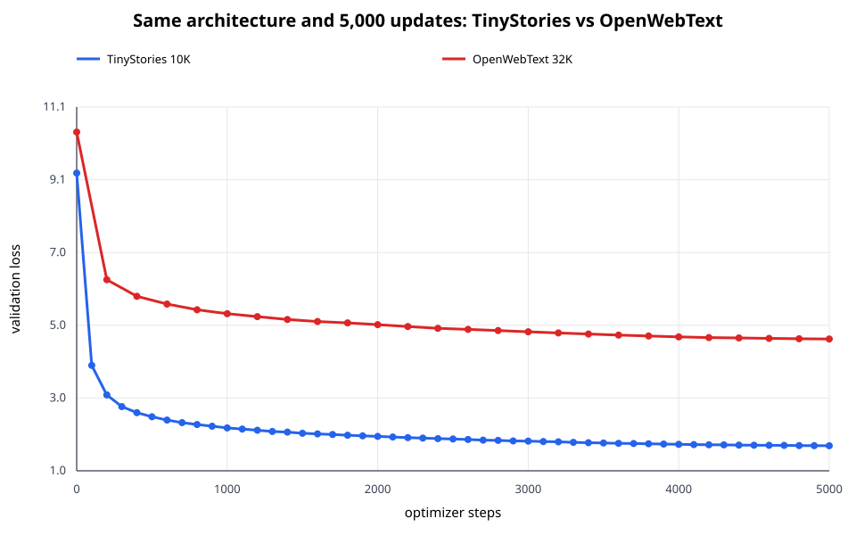
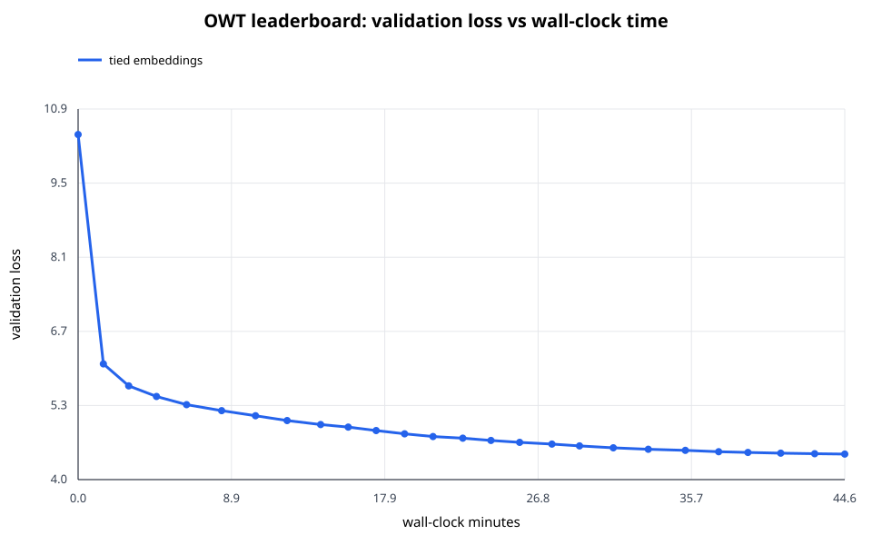

# Assignment 1 — written answers draft

Use this while reading `docs/handouts/cs336_assignment1_basics.md`.  
Final submission is a typeset `writeup.pdf`; this file is your working draft.

---

## §2.1 Problem (unicode1) — Understanding Unicode (1 point)

Status: **done** (concepts confirmed 2026-07-17; formal writeup optional)

**(a)** What Unicode character does `chr(0)` return?

> The NUL character (U+0000).

**(b)** How does this character’s string representation (`__repr__()`) differ from its printed representation?

> `repr` shows an escape like `'\x00'`; `print` typically emits nothing visible.

**(c)** What happens when this character occurs in text?

> It is a valid code point inside a Python `str`, but display/tools may treat it as a control character (invisible, truncate, or warn).

---

## §2.2 Problem (unicode2) — Unicode Encodings (3 points)

Status: **done** (concepts confirmed 2026-07-17; formal writeup optional)

**(a)** Reasons to prefer UTF-8 over UTF-16 / UTF-32 for tokenizer training?

> UTF-8 is variable-width, ASCII-compatible, and dominant on the web; UTF-16/32 waste space on ASCII-heavy text and complicate a small byte alphabet story less cleanly for byte-level BPE.

**(b)** Why is `decode_utf8_bytes_to_str_wrong` incorrect? Give a counterexample.

```python
def decode_utf8_bytes_to_str_wrong(bytestring: bytes):
    return "".join([bytes([b]).decode("utf-8") for b in bytestring])
```

> Counterexample: multi-byte UTF-8 such as `"牛".encode("utf-8")` (or `"こんにちは"`).  
> Why: it decodes each byte in isolation; continuation bytes are not valid standalone UTF-8 sequences.

**(c)** Give a two-byte sequence that does not decode to any Unicode character(s).

> e.g. `b"\x80\x80"` (orphaned continuation bytes) — not a valid UTF-8 encoding of any character. 

---

## §2.5 Problem (train_bpe_tinystories) — BPE Training on TinyStories (2 points)

Status: **DRAFT (agent-written) — owner review pending** (numbers measured 2026-07-19)

Artifacts: `assignments/assignment1-basics/data/ts10k_vocab.json`, `ts10k_merges.txt`
Setup: `vocab_size=10000` (9743 merges), special token `<|endoftext|>`, corpus `TinyStoriesV2-GPT4-train.txt` (~2.1 GB).

**(a)** How much time and memory did training take? What is the longest token in the vocabulary? Does it make sense?

> Training took **16.9 s wall-clock** and **~1.1 GB peak RSS** (macOS `/usr/bin/time -l`; well under the handout’s ≤30 min / ≤30 GB). The longest tokens are **15-byte** English words with a leading space from GPT-2 pretok — ` accomplishment`, ` disappointment`, ` responsibility` — sensible for TinyStories’ moral-of-story vocabulary, where frequent long words fully merge within a pretoken.

**(b)** Profile your code. What part of the tokenizer training process takes the most time?

> After the speed rewrite (parallel pretokenization + incremental merge loop), the bottleneck is **regex pretokenization/counting**: ~0.23 s of ~0.62 s wall time on the 5 MB fixture, while the merge loop is only milliseconds. Before the rewrite, the **full pair recount every merge** dominated instead.

---

## §2.5 Problem (train_bpe_expts_owt) — BPE Training on OpenWebText (2 points)

Status: **DRAFT (agent-written) — owner review pending** (numbers measured 2026-07-19)

Artifacts: `assignments/assignment1-basics/data/owt32k_vocab.json`, `owt32k_merges.txt`
Setup: `vocab_size=32000` (31743 merges), special token `<|endoftext|>`, corpus `owt_train.txt` (~11.9 GB).

**(a)** Train on OpenWebText with a 32K vocabulary. What is the longest token in the vocabulary? Does it make sense?

> Training took **4461.8 s (74.4 min)** wall-clock and **~11.8 GB peak RSS** (well under the handout’s ≤12 h / ≤100 GB). The longest tokens are **64-byte** runs — a mojibake string of double-encoded UTF-8 (`Ã` repeats) and fixed-width separator lines (64 hyphens, a 48-byte em-dash run) — which makes sense: punctuation runs are single pretokens under the GPT-2 regex (` ?[^\s\p{L}\p{N}]+` class), and divider lines are extremely frequent in raw web text, so they win the frequency race at power-of-2 lengths.

**(b)** Compare and contrast the tokenizer trained on TinyStories versus OpenWebText.

> Both vocabularies are topped by frequent *within-pretoken* strings, but each is a fossil of its distribution: TinyStories’ longest tokens are 15-byte moral-of-story words (` responsibility`, ` accomplishment`), while OWT’s are separator/mojibake runs, with real words only reaching ~19 bytes (` disproportionately`, ` telecommunications`).

---

## §2.7 Problem (tokenizer_experiments) — Experiments with tokenizers (4 points)

Status: **DRAFT (agent-written) — owner review pending** (numbers measured 2026-07-19)

**(a)** Compression ratio (bytes/token) on 10 sampled docs each from TinyStories vs OpenWebText.

> TinyStories tokenizer on TinyStories: **4.00 bytes/token** (10 docs sampled from the first 5 MB of train, seed 0; per-doc 3.77–4.29; full valid set 4.12). OWT tokenizer on OWT: **4.44 bytes/token** (per-doc 3.96–5.11).

**(b)** Tokenize OpenWebText sample with the TinyStories tokenizer — compression / qualitative effect.

> Compression drops to **3.30 bytes/token** (−26%, i.e. ~35% more tokens for the same text — cross-distribution tokenizer reuse costs ~35% more compute). Qualitatively, off-distribution words fragment toward bytes: `MONTREAL` → single bytes, ` saga` → ` sa` + `g` + `a`.

**(c)** Tokenizer throughput (bytes/s); time to tokenize the Pile (825 GB).

> Single-threaded pure-Python `encode_iterable` measures **~1.41 MB/s** (22.5 MB in ~15.9 s; 3 runs ±2.6%). At that rate the 825 GB Pile would take ~163 h (6.8 days) single-threaded, or ~10.2 h at 16 workers assuming linear scaling.

**(d)** Why is `uint16` an appropriate choice when serializing token IDs as a NumPy array?

> Our maximum token ID (vocab 32K + specials) fits comfortably in `uint16`’s range `[0, 65535]` — even GPT-2’s 50257 would, while signed `int16` (max 32767) would *not*, so the unsigned headroom is exactly what’s needed. It uses 4× less disk/RAM than NumPy’s default `int64` with zero loss.

---

## §3.5 Problem (transformer_accounting) — Transformer LM resource accounting (5 points)

Status: **DRAFT COMPLETE (agent-written — owner review pending)**

Let `V` be vocabulary size, `T` context length, `L` layers, `D=d_model`, and `F=d_ff`. The assignment
model has separate input/output vocabulary tables and no linear biases, so its parameter count is

`N = 2VD + L(4D² + 3DF + 2D) + D`.

**(a)** For GPT-2 XL shape (`V=50,257`, `T=1,024`, `L=48`, `D=1,600`, `F=4,288`), this is
**1,640,452,800 trainable parameters**. Float32 weights alone require **6.562 GB** (6.111 GiB).

**(b)** Counting multiply and add as two FLOPs, the required matrix multiplications for one sequence
are:

| component | matrix multiplications | FLOPs |
| --- | --- | ---: |
| Q/K/V projections | per layer, three `(T,D)@(D,D)` | `6LTD²` |
| attention scores | per layer/head, `(T,d_h)@(d_h,T)` | `2LT²D` |
| weighted value sum | per layer/head, `(T,T)@(T,d_h)` | `2LT²D` |
| attention output projection | per layer, `(T,D)@(D,D)` | `2LTD²` |
| SwiGLU | per layer, two `(T,D)@(D,F)` and one `(T,F)@(F,D)` | `6LTDF` |
| LM head | `(T,D)@(D,V)` | `2TDV` |

The total is `L(8TD² + 4T²D + 6TDF) + 2TDV`, or **3.51677×10¹² FLOPs**
(3.517 TFLOPs) for GPT-2 XL shape at `T=1,024`. This matrix-multiply accounting omits lookup,
normalization, RoPE, softmax, and element-wise operations.

**(c)** SwiGLU is the largest component at **57.53%**. All token-wise block projections together
dominate because their `D²`/`DF` factors are large; the two quadratic attention-mixing products are
only 9.16% at context 1,024, and the LM head is 4.68%.

**(d)** Component proportions at context 1,024 and vocabulary 50,257 are:

| shape (`d_ff`) | total TFLOPs | QKV | scores `QKᵀ` | value sum `AV` | attn output | SwiGLU | LM head |
| --- | ---: | ---: | ---: | ---: | ---: | ---: | ---: |
| GPT-2 small (`2,048`) | 0.292 | 14.91% | 6.63% | 6.63% | 4.97% | 39.76% | 27.10% |
| GPT-2 medium (`2,752`) | 0.830 | 18.62% | 6.21% | 6.21% | 6.21% | 50.05% | 12.70% |
| GPT-2 large (`3,392`) | 1.769 | 20.49% | 5.46% | 5.46% | 6.83% | 54.30% | 7.45% |
| GPT-2 XL (`4,288`) | 3.517 | 21.47% | 4.58% | 4.58% | 7.16% | 57.53% | 4.68% |

As width/depth increase at fixed `T,V`, the block's `D²` projections and `DF≈D²` FFN take a larger
share. Pairwise attention mixing scales only linearly with `D`, and the vocabulary projection lacks
the `L` multiplier and scales only as `DV`, so both take proportionally less.

**(e)** At context 16,384, GPT-2 XL shape requires **133.578 TFLOPs**, **37.98×** the 1,024-token
forward—not 256×, because only attention mixing is quadratic in `T`. The two pairwise attention
products rise from 9.16% to **61.73%** of the total; SwiGLU falls to 24.24%, token-wise attention
projections to 12.06%, and the LM head to 1.97%.

---

## §4.2 Problem (learning_rate_tuning) — Toy SGD learning rates (1 point)

Status: **DRAFT COMPLETE (agent-written — owner-confirmed reasoning)** (measured 2026-08-25)

With seed 42, LR `10` reduced the loss from 24.1693 to 0.4354 in 10 iterations, much faster
than LR `1` (16.8009). LR `100` left the loss unchanged at 24.1693 because
`w_new = w - 100(2w/100) = -w`, whose square is unchanged. LR `1000` diverged, reaching
`2.52×10²⁴`. Thus a larger LR can accelerate convergence up to the stability boundary, equal
that boundary in this special quadratic case without reducing loss, or overshoot and diverge.

---

## §4.3 Problem (adamw_accounting) — AdamW resource accounting (2 points)

Status: **DRAFT COMPLETE (agent-written — owner review pending)**

Let `B,T,L,D,H,V` denote batch size, context, layers, model width, heads, and vocabulary. With
`F=d_ff=8D/3`, the assignment model's parameter count is

`P = 2VD + L(4D² + 3DF + 2D) + D = 2VD + L(12D² + 2D) + D`.

**(a)** In float32, parameters consume `4P` bytes, gradients `4P`, and AdamW's first/second moments
`8P`. Counting one stored output for each activation component specified by the prompt gives

`A = BL(8TD + 4TF + 2HT²) + B(TD + 2TV)` float32 activation scalars,

or `A = B[L((56/3)TD + 2HT²) + TD + 2TV]` after substituting `F=8D/3`. Activation memory is
`4A` bytes and total peak memory under this simplified inventory is therefore **`16P + 4A` bytes**.

**(b)** For GPT-2 XL shape (`V=50,257`, `T=1,024`, `L=48`, `D=1,600`, `H=25`) and the exact
`F=8D/3` required by this problem, `P=1,635,537,600`. The decomposition in decimal GB is:

| category | memory |
| --- | ---: |
| parameters | 6.542 GB |
| gradients | 6.542 GB |
| AdamW moments | 13.084 GB |
| activations | `16.357B` GB |
| total | **`26.169 + 16.357B` GB** |

An 80GB device therefore fits at most **batch size 3** in this accounting: batch 3 uses 75.238GB,
whereas batch 4 would require 91.595GB. (The earlier §3.5 parameter count is slightly larger because
that problem explicitly rounds `d_ff` to 4,288.)

**(c)** With scalar constants such as `αλ` and `1−β` precomputed, each parameter requires 2 FLOPs
for weight decay, 3 for the first moment, 4 for the second moment (including `g²`), and 5 for the
normalized parameter update (including square root), for approximately **`14P` FLOPs per AdamW
step**. Exact fused-kernel instruction counts vary, but this element-wise cost is tiny relative to the
model forward/backward matrix multiplications.

**(d)** The GPT-2 XL-shaped forward costs 3.50670 TFLOPs per sequence under `F=8D/3`. With backward
twice the forward cost, batch 1,024, and AdamW overhead, each step is approximately
`3×1,024×3.50670 TFLOPs + 14P = 10.7726 PFLOPs`. At 50% of an H100's 495 TFLOP/s peak, effective
throughput is 247.5 TFLOP/s. Thus 400K steps take approximately **17.41 million seconds = 4,836
hours = 201.5 days** on one H100.

---

## Later sections

### §7.1 Problem (experiment_log) — Experiment logging (3 points)

Status: **IN PROGRESS (agent-written) — owner review pending**

The training CLI records JSONL events containing gradient step, cumulative wall time,
training/validation loss, scheduled learning rate, pre-clipping global gradient norm,
step time, and token throughput. Validation uses the same four seeded batches at every
checkpoint, so differences between points and runs are not dominated by changing samples.
Checkpoints separately preserve the best validation state and the latest resumable state.

### §7.2 Problem (learning_rate) — Tune the learning rate (3 points)

Status: **DRAFT COMPLETE (§7.2(a–b), agent-written — owner review pending)**
(measured 2026-08-02)

Search strategy: first bracket several orders of magnitude (`1e-5`, `3e-4`, `3e-2`), then
fill the logarithmic intervals (`1e-4`, `1e-3`, `3e-3`, `1e-2`). Every run used the handout's
base model (`V=10000`, `T=256`, `d_model=512`, `d_ff=1344`, 4 layers, 16 heads), batch size
32, seed 42, AdamW `(beta1,beta2)=(0.9,0.95)`, weight decay 0.1, gradient clipping at 1.0,
10 warmup steps, and cosine decay through step 100. The data, number of updates, validation
batches, and logging cadence were held fixed.

| maximum LR | validation loss, step 25 | step 50 | step 75 | step 100 |
| ---: | ---: | ---: | ---: | ---: |
| `1e-5` | 9.0243 | 8.7836 | 8.6458 | 8.5960 |
| `1e-4` | 7.5741 | 6.4207 | 5.9037 | 5.7391 |
| `3e-4` | 5.9157 | 4.7138 | 4.3692 | 4.2651 |
| `1e-3` | **4.5456** | **3.9415** | **3.7132** | 3.6256 |
| `3e-3` | 4.6684 | 4.0118 | 3.7220 | **3.5892** |
| `1e-2` | 5.5134 | 4.6294 | 4.2928 | 4.1426 |
| `3e-2` | 7.7773 | 5.1765 | 4.8010 | 4.6333 |
| `1e-1` | 6.9047 | 5.9218 | 5.8220 | 5.5335 |
| `3e-1` | 24.2048 | 6.2851 | 6.1466 | 5.8288 |

`1e-5` was stable but spent the budget learning too slowly. `3e-2` overshot early: its
step-10 training loss rose to 10.8013 and its pre-clip gradient norm reached 5.8446. Warmup
and clipping allowed recovery. The completed bracket places the short-run optimum around
`1e-3`–`3e-3`: `3e-3` is the best measured endpoint, but only 0.0364 lower than `1e-3`.
At `1e-2`, the step-10 pre-clip gradient norm reached 7.07 and the final loss regressed,
confirming that the curve had crossed its optimum. The formal `1e-3` run had already reached
validation loss 2.0179 at step 1600 without instability, so it remains the full-run candidate.
The compressed 100-step schedule measures early optimization speed; its tiny ranking
difference is insufficient reason to discard a stable long-horizon trajectory.

Full-run result: using max LR `1e-3`, 200 warmup steps, and cosine decay to `1e-4` at step
5,000, the model processed `32 × 5000 × 256 = 40,960,000` tokens. Validation loss fell from
**9.2500** to **1.6903**, crossing the low-resource target of 2.00 at step 1,800. All later
fixed-validation measurements improved, so the final checkpoint was also the best observed.
Trajectory wall time was **3,264 seconds (54.4 minutes)** on MPS. Pre-clip gradient norms
remained around 0.4–0.5, while noisy individual training batches ranged more widely; the
smooth 20-batch validation average is therefore the model-selection evidence.

For the edge-of-stability check, `1e-1` produced a step-10 training-loss spike to 18.05 and
then plateaued at a poor validation loss of 5.53. `3e-1` is the unambiguous divergent case:
training loss reached 54.12, the pre-clip gradient norm reached 22.27, and validation loss
rose from 9.25 to **24.20** at step 25. It recovered only after cosine decay lowered the LR,
ending at 5.83. This shows that divergence need not produce NaNs and that clipping limits
individual update magnitude without making an excessive LR useful. Increasing LR first
accelerates convergence, then causes recoverable oscillation, and eventually moves the model
into a region from which progress resumes only after LR decays.

### §7.2 Problem (batch_size_experiment) — Batch size variations (1 point)

Status: **DRAFT COMPLETE (agent-written — owner review pending)** (measured 2026-08-03)

Runs were compared at equal processed tokens, not equal updates:
`batch × steps × 256 = 2,097,152`. All curves use the same four fixed batch-32 validation
samples. Peak LR was initially scaled linearly from `1e-3` at batch 32; unstable or poor
large-batch settings were re-run at half LR.

| batch | steps | selected peak LR | final validation loss | wall time | effective throughput |
| ---: | ---: | ---: | ---: | ---: | ---: |
| 1 | 8192 | `3.125e-5` | 3.5510 | 333.8 s | 6.28k tok/s |
| 8 | 1024 | `2.5e-4` | 3.0053 | 210.8 s | 9.95k tok/s |
| 32 | 256 | `1e-3` | **2.9074** | 173.2 s | 12.11k tok/s |
| 64 | 128 | `2e-3` | 3.2118 | **165.4 s** | **12.68k tok/s** |
| 128 | 64 | `2e-3` | 3.6580 | 178.6 s | 11.74k tok/s |
| 256 | 32 | `4e-3` | 4.3491 | 206.3 s | 10.16k tok/s |

Increasing batch from 1 to 32 reduced noisy gradients and raised hardware utilization, so
both validation loss and elapsed time improved. B64 was only 4.7% faster than B32 but ended
0.304 loss worse. Beyond that point, fewer optimizer updates at equal tokens outweighed the
remaining variance reduction, while MPS memory pressure reduced throughput. B256 completed
but used 38.5 GiB of driver memory versus a 37.4 GiB recommended limit.

LR retuning improved B128 from 3.939 (`4e-3`) to 3.658 (`2e-3`) and B256 from 5.007
(`8e-3`) to 4.349 (`4e-3`), confirming that linear LR scaling had crossed the useful range.
However, B64 became worse when reduced from `2e-3` to `1e-3` (3.212 → 3.296), and the
retuned larger batches still trailed B32. Thus LR explains part but not all of the deficit;
the useful batch region for this model, token budget, and MPS device is approximately 32–64.

### §7.2 Problem (generate) — Generate text (1 point)

Status: **DRAFT COMPLETE (agent-written — owner review pending)** (generated 2026-08-10)

Checkpoint: TinyStories low-resource run, 40.96M training tokens, validation loss 1.6903.
Prompt: `Once upon a time`. Decoder: temperature `0.8`, top-p `0.5`, seed `42`.
The model emitted EOT after 184 new tokens, so the handout's “256 tokens or until EOT”
condition is satisfied.

> Once upon a time, there was a little girl named Lily. She loved to play with her toys and
> have fun. One day, she found a big box in her room. She was very excited and wanted to open
> it.
>
> Lily opened the box and found a big, soft ball. She played with the ball all day. She was so
> happy and ran around the room. But then, something unexpected happened. The ball started to
> talk! It said, “I am a magic ball! I can make your wishes come true!”
>
> Lily was very surprised. She did not know that the magic ball could talk. The magic ball
> said, “I can make your wishes come true!” Lily was very surprised. She wished for a big ice
> cream cone to share with her friends. The magic ball made her wish come true. Lily was so
> happy and surprised. She learned that sharing and being kind made her wish come true.

The output is fluent at the sentence level and maintains a recognizable TinyStories plot,
but it repeats the wish sentence and “surprised,” then gives a weak causal moral. Important
quality factors are: **(1) training evidence**—the limited 40.96M-token budget and 1.6903
validation loss leave semantic and long-range consistency errors; **(2) decoding policy**—a
lower temperature or tighter top-p suppresses unlikely continuations and usually improves
local coherence at the cost of diversity; and **(3) context/history**—each sampled token
changes all later conditionals, while tokens outside the 256-token context window are no
longer visible. The seed changes the sampled path but not the underlying model distribution.

A greedy comparison was exactly reproducible and grammatical, but ended by reversing which
child had lost the toy. A more open `temperature=0.8, top_p=0.9` sample became trapped in
repetition around the word “powder.” Thus decoding can trade diversity against coherence,
but it cannot repair knowledge or consistency that the trained distribution has not learned.

### §7.3 Problem (layer_norm_ablation) — Remove RMSNorm and train (1 point)

Status: **DRAFT COMPLETE (agent-written — owner review pending)** (measured 2026-08-11)



All runs used the same base model dimensions, TinyStories data, batch 32, context 256,
initialization/data seed 42, four fixed validation batches, 10 warmup steps, and a 100-step
cosine schedule. The old best endpoint from the LR sweep was peak LR `3e-3`.

| architecture / peak LR | validation loss at 0 | 25 | 50 | 75 | 100 |
| --- | ---: | ---: | ---: | ---: | ---: | ---: |
| pre-norm / `3e-3` | 9.249 | 4.668 | 4.012 | 3.722 | 3.589 |
| no norm / `3e-3` | 16.170 | 2,322 | 6,559 | 197,508 | 63,151 |
| no norm / `1e-3` | 16.170 | 4.926 | 4.050 | 3.708 | **3.556** |
| no norm / `3e-4` | 16.170 | 6.082 | 4.799 | 4.407 | 4.279 |

Removing RMSNorm made the old `3e-3` optimum violently unstable without immediately creating
NaNs: the pre-clipping gradient norm reached 705 at step 20, 446,056 at step 30, and 19.7
million at step 50. Gradient clipping at 1.0 kept the parameters finite but did not produce a
useful trajectory. Lowering peak LR to `1e-3` restored stability and gave the best no-norm
endpoint tested, 3.556; `3e-4` was stable but learned too slowly.

The forward pass shows why. With identical initialization and inputs, the RMS of successive
block outputs was `1.08, 1.18, 1.28, 1.40` for pre-norm but `1.08, 1.26, 1.93, 14.53`
without normalization; final logit RMS increased from 0.31 to 4.48. RMSNorm therefore keeps
each attention/FFN input at a predictable scale and greatly widens the usable LR range. A
lower LR only reduces parameter-update size; it does not restore that architectural scale
invariance. The no-norm `1e-3` endpoint narrowly beating pre-norm in this short run is not
evidence that normalization is unnecessary—the decisive result is robustness at the tuned LR,
and longer/deeper runs would be needed for a quality claim.

### §7.3 Problem (pre_norm_ablation) — Implement post-norm and train (1 point)

Status: **DRAFT COMPLETE (agent-written — owner review pending)** (measured 2026-08-14)



The post-norm implementation follows equations 27–28: each RMSNorm is applied after its
residual addition, and there is no redundant final RMSNorm after the last already-normalized
block. All runs otherwise share the no-norm experiment's model, data, seed, batch, validation,
10-step warmup, and 100-step cosine schedule.

| architecture / peak LR | validation loss at 0 | 25 | 50 | 75 | 100 |
| --- | ---: | ---: | ---: | ---: | ---: | ---: |
| pre-norm / `3e-3` | 9.249 | 4.668 | 4.012 | 3.722 | **3.589** |
| post-norm / `3e-3` | 9.247 | 5.964 | 5.881 | 5.854 | 5.837 |
| pre-norm / `1e-3` | 9.249 | 4.546 | 3.942 | 3.713 | 3.626 |
| post-norm / `1e-3` | 9.247 | 4.749 | 3.982 | 3.712 | **3.593** |

At the old short-run optimum `3e-3`, post-norm remained finite but plateaued near 5.84,
whereas pre-norm reached 3.59. Reducing post-norm's peak LR to `1e-3` restored normal learning
and produced a 3.593 endpoint, essentially equal to the best pre-norm endpoint in this short
four-layer experiment. Thus the empirical result is that post-norm has a narrower useful LR
range, not that it is incapable of training.

Mechanistically, pre-norm leaves an identity derivative term through every residual block,
while post-norm forces the residual gradient through the RMSNorm Jacobian after each addition.
That distinction becomes increasingly important with depth. However, initial per-block
gradient norms in this four-layer model were finite and comparable, so the bad `3e-3` curve
cannot honestly be labeled observed gradient vanishing. The evidence supports increased
optimization sensitivity and the consensus preference for pre-norm's robust gradient path.

### §7.3 Problem (no_pos_emb) — Implement NoPE (1 point)

Status: **DRAFT COMPLETE (agent-written — owner review pending)** (measured 2026-08-16)



The NoPE variant removes RoPE from every attention layer while retaining the causal mask.
Both curves use identical model weights at initialization, data order, seed, batch 32, context
256, four validation batches, peak LR `3e-3`, 10-step warmup, and 100-step cosine decay.

| position scheme | validation loss at 0 | 25 | 50 | 75 | 100 |
| --- | ---: | ---: | ---: | ---: | ---: |
| RoPE | 9.249 | 4.668 | 4.012 | 3.722 | **3.589** |
| NoPE | 9.250 | 4.566 | 4.084 | 3.907 | 3.825 |

NoPE trained normally and was slightly ahead at step 25, but RoPE pulled ahead thereafter
and finished 0.236 validation loss lower. A causal decoder is not completely order-blind
without explicit positions: each earlier token representation is computed from a different
allowed prefix, so later layers can infer order from these nested histories. A direct probe
showed that one NoPE layer produced effectively identical final logits for `[A,B,C]` and
`[B,A,C]` (maximum difference `3e-7`), while two NoPE layers produced a 0.638 difference;
one RoPE layer already produced a 0.091 difference.

Thus NoPE can reconstruct useful positional structure but must spend depth and capacity doing
so. RoPE exposes relative position directly in Q/K matching, improving later optimization and
likely helping distance-sensitive, counting, copying, and repeated-token behavior. Because
RoPE uses fixed rotations, it adds no learned parameters and does not change the dominant
quadratic attention complexity, making the measured quality gain inexpensive.

### §7.3 Problem (swiglu_ablation) — SwiGLU versus SiLU (1 point)

Status: **DRAFT COMPLETE (agent-written — owner review pending)** (measured 2026-08-16)



To avoid conflating gating with capacity, the baseline uses SwiGLU `d_ff=1344` and the
ungated SiLU FFN uses `d_ff=2048`, as prescribed by the handout. For `D=512`, the resulting
single-block FFNs contain 2,064,384 and 2,097,152 parameters respectively; the complete models
contain 22,696,448 and 22,827,520 parameters, only a 0.58% difference. Both runs otherwise use
the same RoPE pre-norm architecture, data, seed, batch 32, context 256, peak LR `3e-3`,
10-step warmup, validation samples, and 100-step cosine schedule.

| FFN | validation loss at 0 | 25 | 50 | 75 | 100 |
| --- | ---: | ---: | ---: | ---: | ---: | ---: |
| SwiGLU | 9.249 | 4.668 | 4.012 | 3.722 | **3.589** |
| SiLU | 9.269 | 4.999 | 4.248 | 3.932 | 3.782 |

SwiGLU finished 0.192 validation loss lower even though the SiLU model had slightly more
parameters. The multiplicative gate `SiLU(W1x) ⊙ W3x` lets the current contextual token
dynamically suppress or pass independently projected content features, an interaction absent
from `W2(SiLU(W1x))`. The controlled result therefore supports greater parameter efficiency
from gating in this setting. Because this is one seed and a short TinyStories budget, it does
not by itself prove universal superiority across training duration, datasets, or model scales.

### §7.4 Problem (main_experiment) — Train on OpenWebText (2 points)

Status: **DRAFT COMPLETE (agent-written — owner review pending)** (measured 2026-08-17)



The OpenWebText run used the same pre-norm/RoPE/SwiGLU architecture dimensions and 5,000
optimizer updates as TinyStories, with effective batch 32 and context 256: 40.96M training
tokens in each case. OWT used its required 32K tokenizer, so its embedding/output tables make
the complete model 45.22M parameters versus 22.70M with the TinyStories 10K tokenizer. A
short controlled check selected peak LR `1e-3`; the full schedule used 200 warmup steps and
cosine decay to `1e-4`.

OWT validation loss decreased monotonically from **10.3862 to 4.6485**. The first 200 steps
ran in FP32; after a checkpoint-matched probe found only a 0.00026 same-batch loss difference,
the remaining run used BF16 autocast while retaining FP32 parameters and AdamW state. This
raised throughput to roughly 9–10K tokens/s without a visible curve discontinuity. The final
checkpoint was also the best. TinyStories under the same update/token budget reached 1.6903.

The raw endpoints are not directly comparable measures of model quality. Cross-entropy is per
token, while OWT uses 32K token units and TinyStories uses 10K; their random-uniform starting
losses already differ (`ln(32000)≈10.37` versus `ln(10000)≈9.21`). Normalizing approximately
by bytes/token gives 1.06 nats/byte for OWT and 0.41 for TinyStories, but this still compares
the predictability of two different distributions, not pure model skill. OWT contains more
domains, entities, styles, noise, and long-range dependencies. Moreover, 40.96M tokens cover
only about 1.5% of the 2.727B-token OWT corpus versus about 7.6% of the 541M-token TinyStories
corpus. The OWT model must therefore spread finite capacity and updates across a much broader
distribution, while the 256-token context truncates more relevant history.

Generated sample: prompt `The researchers found that`, temperature `0.8`, top-p `0.9`, seed
`7`, 256 new tokens; it did not emit EOT within the limit.

> The researchers found that the data from the past few years may have been “sacked” since
> the 2011 summit in mid-2011, but that number is the real survey.
>
> “It’s interesting to see how we have different times,” said Don Poss, executive director
> of the paper at the University of California at the University of Wisconsin and the
> University of California at Illinois University. “It’s not good enough that we know that
> a lot of people still live on the same day, but this is not just in the world and we are in
> the community, but we’re going to get that.”
>
> A Purchin said that the results from the study was at a time when the data was provided by
> the data, and that it was “confused” to make the data available to the data. It’s not a
> better source of information from the data we’ve discussed before.
>
> The survey, found that in the survey, the survey found that the survey is about 2.7% or
> 0.1% of the data showed that data.
>
> “The data is a significantly higher than the data we conducted and the information that
> data were relevant, and the data on data were shared in our data,” said a document in the
> paper

The sample has learned recognizable web/news-science surface structure: paragraphs,
attributed quotations, institutions, percentages, and report-like transitions. It is not
semantically fluent: institutions and people are fabricated, claims do not compose, grammar
degrades, and “data/survey” loops recur. Greedy decoding was worse, collapsing into repeated
“the researchers found that” and “the data was not the data” phrases. Sampling avoids the
single highest-probability repetition loop and adds diversity, but it cannot supply factual
or long-range structure absent from the undertrained model. Full outputs are retained under
`runs/owt_generation/`.

### §7.5 Problem (leaderboard) — Scale-aware weight tying (6 points)

Status: **DRAFT COMPLETE (agent-written — owner review pending)** (measured 2026-08-17)



I tied the input token-embedding and output LM-head weights, reducing unique parameters from
45,224,448 to 28,840,448 (36.23%). Sharing does not remove the `D×V` logits matrix multiply or any
Transformer-block arithmetic, but it removes one 32K×512 table and its gradient and AdamW states.
It also trains each vocabulary row through both its input and target roles.

A naive tie performed worse because one table must serve incompatible default scales: std-1 lookup
embeddings are normalized safely by the first RMSNorm but produce unusably large classifier logits.
I initialized the shared table with std `0.02` and multiplied only its lookup output by `sqrt(512)`,
preserving a useful residual-stream scale without enlarging output logits. At the same LR `1e-3`, a
controlled 100-step OWT comparison reached validation loss 6.594 tied versus 6.750 untied; tuning the
tied model to LR `2e-3` improved it to 6.533. The formal configuration used the base 4-layer,
`D=512`, 16-head, SwiGLU `d_ff=1344` model, context 256,
effective batch 32, BF16 autocast with FP32 parameters/AdamW state, peak LR `2e-3`, 200 warmup
updates, and cosine decay to `2e-4` through update 5,000.

The final validation loss was **4.43271** at update 5,000 after **2,678.87 seconds (44.65 minutes)**.
It was also the best checkpoint, and all 26 validation measurements improved monotonically. This is
0.21582 below the untied 5,000-step OWT endpoint of 4.64853 and beats the expected 5.0 baseline.
The curve's x-axis is measured wall-clock time and ends 21.13 seconds below 45 minutes. This was a
local M5 Pro low-power self-study run rather than an official B200 leaderboard submission, so the
hardware timing should be treated as a local proxy; the configuration and learning-curve evidence
are otherwise recorded reproducibly in `training_profiles.toml` and `runs/owt_leaderboard_tied/`.

*(remaining model, loss, and training experiment answers to be added)*
